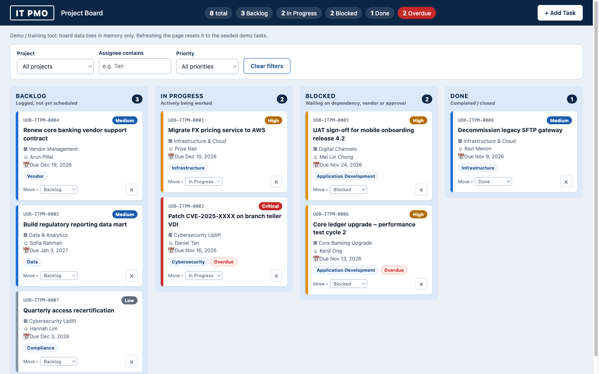
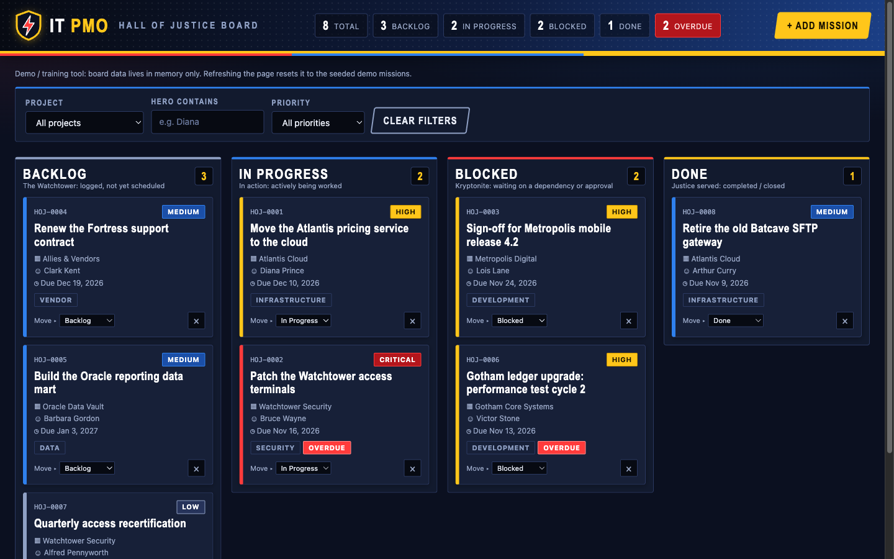
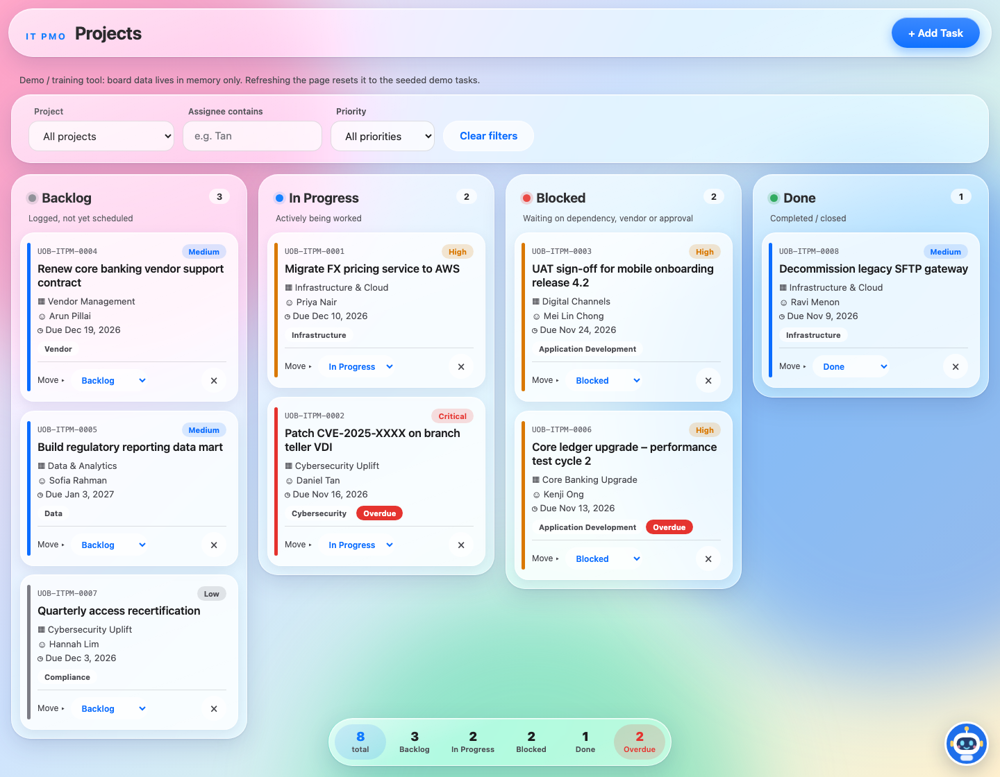
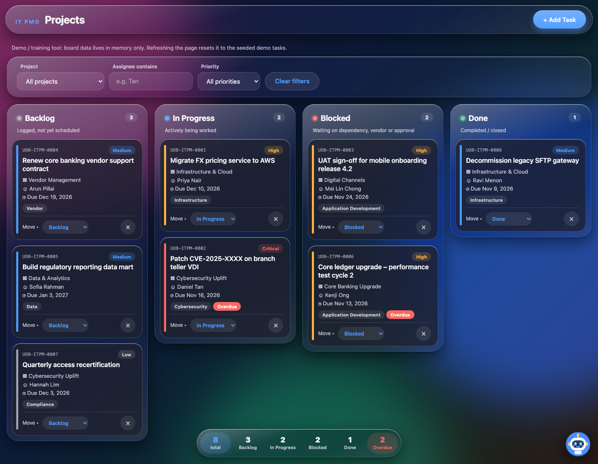
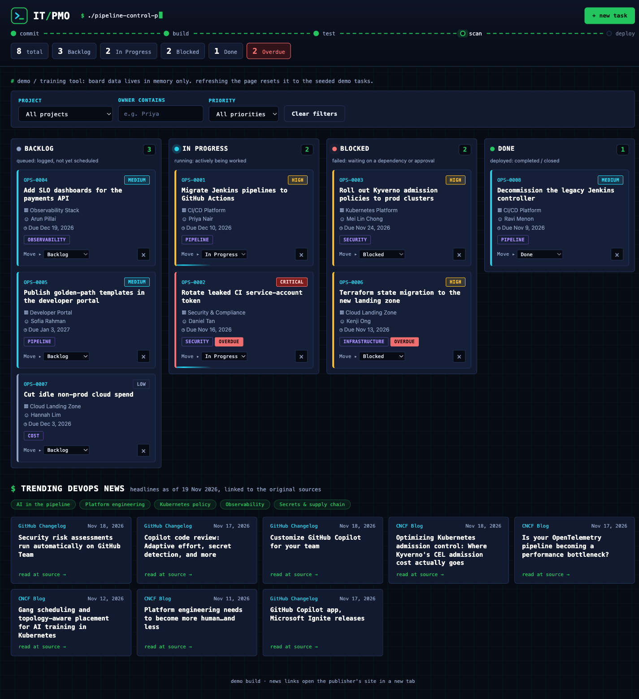
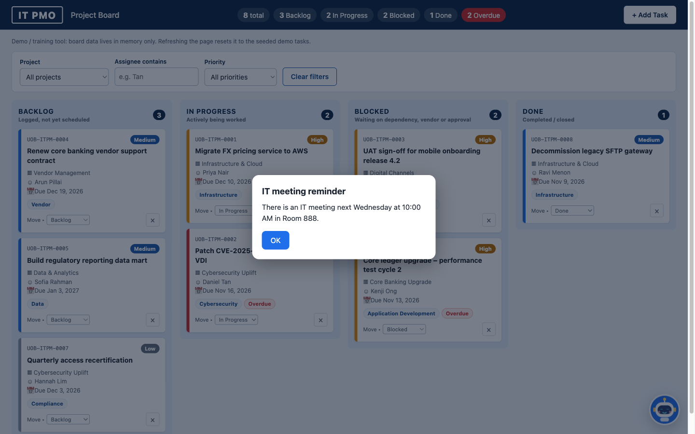

# IT PMO Kanban Board

A single-file Kanban board for a fictitious bank's IT PMO, built with plain HTML, CSS and JavaScript. No framework, no build step and no external resources.

**Live demo:** https://ume5hv.github.io/kanban/
**DC superhero version:** https://ume5hv.github.io/kanban/dc.html
**DevOps version:** https://ume5hv.github.io/kanban/devops.html
**Liquid glass version:** https://ume5hv.github.io/kanban/ios.html

## Screenshots

| Original (`index.html`) | DC superhero redesign (`dc.html`) |
|---|---|
|  |  |

### Liquid glass redesign (`ios.html`)

| Light | Dark |
|---|---|
|  |  |

An iOS-inspired design with a slowly drifting pastel wallpaper and frosted-glass panels. It has a pill navigation bar with a large title, a floating dock that shows the live summary, spring-eased card animations, a bottom-sheet form and iOS-style notification banners. Light and dark modes follow the device setting, and it respects reduced motion and reduced transparency. It uses no Apple logos or assets. The screenshots were taken in headless Brave, which adds its own small assistant button in the bottom-right corner; that button is not part of the page.

### DevOps redesign (`devops.html`)



A terminal-style "Pipeline Control Plane": an animated commit-to-deploy strip in the header, status lights per column, a scanning bar on running cards, and a "Trending DevOps news" section. The news is a static list of dated headlines linked to GitHub's changelog and the CNCF blog. Edit the `NEWS` array in `devops.html` to refresh it. Animations respect the reduced-motion setting.

The DC redesign keeps all behaviour from the original. Only the styling, the wording and the demo data changed. It is a fan-made, original design with no official logos or artwork, and is not affiliated with DC or Warner Bros.

## Screenshot


### Hooks (meeting reminder and IT assistant)

After 10 seconds on the page the meeting reminder dialog appears, and the IT assistant avatar sits at the bottom right. Captured with Playwright MCP.



## Features

- Four columns: Backlog, In Progress, Blocked and Done.
- Drag and drop between columns, plus a keyboard-accessible "Move ▸" select on every card.
- Priority-coloured card borders, an Overdue badge and an inline "Delete? Yes / No" confirmation.
- Add Task form with inline validation, task IDs in the format `UOB-ITPM-####`, an optimistic add and a success toast.
- Filters by project, assignee and priority, and a live summary of totals, status counts and overdue tasks.
- Eight seeded demo tasks.

## Run it

Open `index.html` in a browser, or serve the folder:

```bash
python3 -m http.server 8765
```

Then open http://localhost:8765/.

## Configuration

Set `FORMSUBMIT_ENDPOINT` near the top of the script in `index.html` to your own address, for example `https://formsubmit.co/ajax/you@example.com`. FormSubmit asks you to confirm the address by email the first time a task is added. Until it is set, adding a task still works and shows the warning "Card added locally — email notification failed".

## Known limits

- Data lives in memory only, so a refresh resets the board to the demo tasks. Real persistence needs a backend or storage layer.
- The page makes one network call: the FormSubmit request when a task is added.
- This is a demo with a neutral "IT PMO" wordmark. It uses no real bank logo or trademarks.

## Deployment

A GitHub Actions workflow (`.github/workflows/main.yml`) publishes `index.html` to GitHub Pages on every push to `main`.
